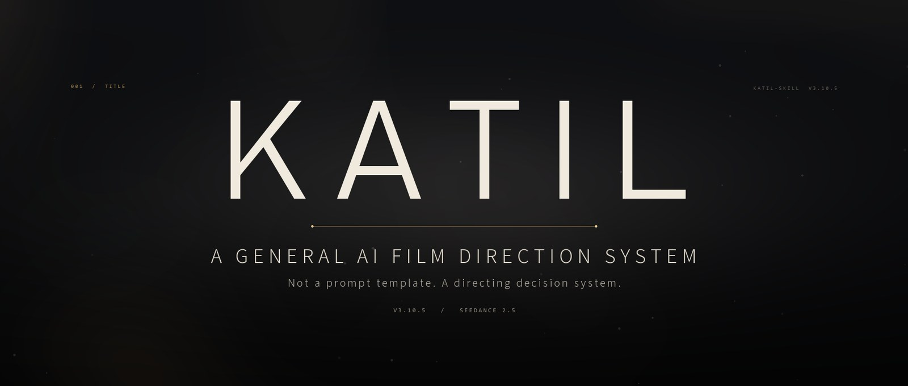

<div align="center">
  

  <h1>KATIL-skill</h1>

  <p><b>A general AI film direction system</b><br/>
  Not a prompt template — a directing decision system.</p>

  <p>
    <a href="README.md"><b>中文</b></a> ·
    <a href="SKILL.md">Skill entry</a> ·
    <a href="docs/requirement-optimizer.en.md">Requirement optimizer</a> ·
    <a href="CHANGELOG.md">Changelog</a> ·
    <a href="#quick-start">Quick start</a>
  </p>

  <p>
    <a href="https://github.com/Mcz070321/katil-skill/releases"></a>
    
    <a href="https://github.com/Mcz070321/katil-skill/actions/workflows/ci.yml"></a>
    
    
    
  </p>
</div>

---

## What this is

KATIL-skill is an **AI film-direction system** distributed as an agent skill, entered through [SKILL.md](SKILL.md). It turns a loose creative request into a shootable shot design, then delivers copy-ready prompts in both Chinese and English.

It assumes no genre. Action, horror, romance, advertising, animation, documentary, experimental film — all are optional dimensions of one decision process. The process first decides *what is being made*, then decides *which modules are loaded and which one leads*.

It also assumes no model. The default output is platform-agnostic; the Seedance 2.5 execution adapter is loaded only when you explicitly ask for it.

> In one line: **it decides how the scene should be directed before it decides how the paragraph should be written.**

### What it is not

- **Not a genre template pack.** There is no "action template" or "horror template" to fill in; modules load on demand, and each decision domain has exactly one lead.
- **Not a prompt beautifier.** It changes events, causality, observation paths and capacity — not adjectives.
- **Not a video model or an editor.** It does not generate video, transcode files, or repair media.
- **It does not promise what it cannot show.** Every conclusion carries an evidence level (EV0–EV3): a structural pass is written as "structure passes", and without a real generation watched end to end it never becomes "the footage improved". Rules: [references/evidence-and-claims.md](references/evidence-and-claims.md).

> **Language note:** the skill body — `SKILL.md`, references and rules — is authored in Chinese and is the canonical source. Delivered prompts are bilingual by default (a complete Chinese block and a complete English block). You can write requests in English; the reference documents themselves are not translated.

## Why it exists

| Common practice | What KATIL does instead |
| --- | --- |
| One template for every genre; everything looks the same | A nine-dimension task contract comes first, then modules are assigned per decision domain |
| Write Chinese, machine-translate English, facts drift | One set of events and states is fixed first; both languages are written from it; quoted dialogue stays verbatim |
| Stack effects, shots and seconds up front | Check duration and event capacity first; overload and state conflicts are repaired before delivery |
| Model parameters leak into creative rules | The adapter only reorganises expression; it never silently changes hard requirements |
| Declare an upgrade because it "feels better" | Text acceptance and video acceptance are recorded separately and never impersonate each other |

## Core design

1. **A nine-dimension task contract** — lead intent, genre, medium, form, directing mode, duration and platform, audience and use, hard constraints, success criteria. Nothing already given is asked again; a missing field is only asked when it genuinely changes the outcome.
2. **One lead per decision domain** — genres may be mixed and modules may coexist (e.g. horror + romance + 2D animation), but a single decision domain can never have two leads fighting each other.
3. **Event order by default, not timecodes** — `Shot 01` for multiple shots, `Phase 01` for a true oner, `Panel 01` for storyboards. Capacity is checked only when a duration is given; second-level precision is reserved for sync, confirmed edit windows and similar necessities.
4. **Three reference-image states** — no reference / ordinary reference / locked first and last frames. Each state is written differently; there is no "if a reference image is provided…" filler.
5. **Three spatial modes** — S1 screen coordinates (default; performance and narrative), S2 world coordinates (architecture, products, scientific visualisation), S3 hybrid (complex action, giant subjects, aerial combat).
6. **Independent bilingual copy blocks** — every segment gets one complete, clean, paste-ready block per language. The English block is not a summary; changing either version means updating the other.
7. **Repair before delivery** — capacity, state continuity, hand occupancy and support points, and end-state support are checked item by item. Found conflicts are fixed in the prompt body, not noted internally.
8. **Layered acceptance** — text acceptance can run now; video acceptance requires a real generation and a real viewing pass. They are recorded separately, and small samples are marked "uncertain".
9. **Evidence levels (EV0–EV3)** — design, text-and-structure, single-generation observation, and repeated same-condition blind review are labelled separately: an EV1 structural PASS never becomes a footage PASS, and anything not watched in full stays "pending". Model facts are likewise split into official documentation, platform measurements and unverified assumptions; official docs alone cannot justify "compatible".
10. **Effects scheduled as events (FX Director 2.0)** — effects are not adjectives but an event layer: 15 visual-effect classes, a six-layer schedule (narrative intent / physical mechanism / procedural lifecycle / engine visual grammar / optics and compositing / event sync), one lead class plus 0–3 supporting classes, and three complexity budgets. The FX layer rules on classification and scheduling only; it never rewrites abilities, injuries, action outcomes, camera locks or sound permissions. Engine names are visual grammar references, not real engine calls.
11. **Irreversible endings and tail lock** — fix the S0→Sn state chain and the giant-scale ladder before writing the process; once a decisive result lands, the tail only carries its immediate aftermath and settling, never a second ending. An impact frame may briefly occlude the contact point, but the result must be visible once the frame recovers.

## The FX directing layer (3.10)

Visual effects are no longer "add more particles"; they are an event layer that can be scheduled and reviewed. The flow asks what state this blow or this scene changes, then decides which FX classes to use, who leads, and what budget applies.

- **Classification and six-layer scheduling** — 15 visual-effect classes, one lead + 0–3 supporting, the A–H decision flow and three budgets, in [fx-director.md](references/fx-director.md).
- **Procedural lifecycle** — onset, sustain, decay, residue and motion fields, so particles do not simply vanish, in [procedural-fx-grammar.md](references/procedural-fx-grammar.md).
- **Engine visual translation** — Niagara / Chaos / Lumen are visual grammar references, not real engine calls, in [engine-fx-visual-mapping.md](references/engine-fx-visual-mapping.md).
- **Optics and compositing** — exposure, depth of field, motion blur, dispersion, smoke occlusion and layer order, in [optical-and-compositing-grammar.md](references/optical-and-compositing-grammar.md).
- **Event-level sync** — action, environment, camera, FX and sound aligned on the same event, in [fx-synchronization.md](references/fx-synchronization.md); fidelity checks when compressing long drafts in [fx-compilation-and-fidelity.md](references/fx-compilation-and-fidelity.md).

## Quick start

### 1. Get it

```bash
git clone https://github.com/Mcz070321/katil-skill.git
```

### 2. Install into your agent's skills directory

Move the whole directory in, keeping the name `katil-skill`:

```bash
# Claude Code
mv katil-skill ~/.claude/skills/katil-skill

# Other runtimes that understand Agent Skills / SKILL.md
mv katil-skill ~/.agents/skills/katil-skill
```

The entry point is [SKILL.md](SKILL.md); [manifest.yaml](manifest.yaml) declares version, compatibility range and validation scope; [agents/openai.yaml](agents/openai.yaml) provides the display name and default prompt for runtimes that read that manifest.

The archive also carries an action compatibility entry. This repository keeps it at compatibility/direct-cinematic-fights/ (5 files); it is only needed when a runtime loads nested skill directories. For a standalone install, copy that directory next to katil-skill in your skills path. The main entry remains katil-skill alone.

### 3. Trigger it

Say **KATIL** or **提示词 skill** in the conversation, or simply describe the film task you want.

### 4. A minimal task

> Use KATIL to write a 30-second rainy-night convenience-store scene: a girl just off the night shift realises the clerk is a classmate she hasn't seen in years. Keep it restrained. No music.

What you should get: a confirmed task contract → at most one necessary follow-up question → character / location / video prompts → a Chinese copy block plus an equivalent English copy block → a short pre-delivery self-check kept outside the blocks.

## Companion tool: the requirement optimizer

Half of what KATIL can do is set by the request you give it. If all you have is one idea, a pile of scattered notes, an old prompt, a passage of source prose or feedback on a generation, run it through the companion **requirement optimizer** first and hand KATIL something it can execute.

- Chinese edition: [docs/requirement-optimizer.md](docs/requirement-optimizer.md)
- English edition: [docs/requirement-optimizer.en.md](docs/requirement-optimizer.en.md)

Three steps:

1. Give the file to any text-capable AI as its working rules for this round; upload it directly in chats that accept files.
2. State your raw idea. If you have source text, reference images, a previous prompt or a generated result, provide the actual content with it.
3. Send the single code block it returns to the assistant running KATIL-skill, re-attaching the same material.

It works on the layer *above* the skill — the "I can't say what I want" layer. It splits a vague request into goal and experience, must-keep items, focus areas, design latitude and delivery scope, and keeps hard constraints, preferences and undetermined details apart. It will not write your storyboard, invent plot you never mentioned, or lock a duration or aspect ratio you never specified.

Two boundaries worth stating: the optimizer produces a **requirement brief for KATIL**, not a final video prompt, and it neither carries attachments nor installs KATIL. The file itself notes that it was organised from the V3.7.2 working method — if your KATIL is newer, the rules of the installed skill and your request for that round win.

## What the output looks like

The blocks below are a **format illustration** — they show event order, positive description and the Chinese/English correspondence. They are not a quality claim.

**Chinese copy block**

```text
分镜01 雨夜，便利店的自动门在女孩身后合拢，把街上的雨声压成一条细线。她停在关东煮的热气前，手指还捏着工牌挂绳。
分镜02 收银台后的店员抬头，目光在她工牌上停住；他手里的扫码枪垂下，红光落在台面上。女孩顺着他的视线低头，把工牌翻了过去。
分镜03 两人隔着热气对视，谁都没有先开口。冰柜压缩机启动，灯光轻轻一颤；女孩把伞靠在门边，伞尖的水在瓷砖上摊开一小片。
```

**English copy block**

```text
Shot 01 Rainy night. The automatic door closes behind the girl, narrowing the street noise to a thin line. She stops in front of the steam from the oden pot, still holding the lanyard of her work badge.
Shot 02 The clerk behind the counter looks up; his gaze catches on her badge. The scanner lowers in his hand, its red light pooling on the counter. She follows his look and turns the badge face-down.
Shot 03 They hold each other's gaze through the steam, neither speaking first. The freezer compressor kicks in; the light trembles slightly. She leans her umbrella by the door, and the water at its tip spreads across the tiles.
```

A few deliberate choices: no timecodes, no adjective stacking, no "do not…" exposition, every shot lands on a visible change, and both languages carry the same events.

## Ability and style libraries

- **240 ability cards (C01–C24)** — C01–C20 are character abilities across realistic, sci-fi and fantasy worlds; C21–C24 add non-combat screen effects for any genre: commercial macro and product effects, natural phenomena and macro spectacle, dream logic and surreal transitions, and uncanny folklore atmospheres. Each card is organised as mechanism and use / action and response / effect description / limits and counters / camera and sound / residue and continuity, so an ability is never a cost-free win button.
- **60 visual-style recipes (F01–F10)** — from live-action documentary to Japanese 2D animation, traditional painting media, stop motion and experimental hybrid work. Each recipe ships character-image, location-image and video style fragments **in both Chinese and English**.
- **15 authoritative rules** — with SHA-256 provenance and summary blocks, in [rules/rule-registry.yaml](rules/rule-registry.yaml). EVIDENCE 1.0.0 defines the evidence levels and the boundaries of release claims; FX_DIRECTOR / FX_PROCEDURAL / FX_ENGINE / FX_OPTICAL / FX_SYNC govern FX scheduling, lifecycle, engine translation, optics and sync.

Both libraries are read-only lookups; you never have to open the full JSON:

```bash
python scripts/ability_library.py --query "冰" --limit 2
python scripts/style_library.py --list-families
python scripts/style_library.py --family F06 --limit 2
```

<details>
<summary>Sample output (excerpt)</summary>

```text
## A131 冰楔错步
适用：奇幻｜冰水与流体｜控制、进攻
- 机制与用途：霜契者抽取附近水洼的水并耗去寒纹，在对手前脚落点形成浅冰楔，
  以突变坡度打乱重心而非冻结整个人。
- 限制与反制：需要近处有水且落点可见，寒纹用尽便不能成冰；
  砂砾铺面、提前跳跨或重踏破楔都能反制。
```

```text
F06 日式二维动画: S031-S036
匹配6项，显示2项；风格片段需融入实际设计。
```

</details>

## Repository layout

```text
katil-skill/
├─ SKILL.md                Skill entry: the nine-step flow and the "read by task" routing table
├─ manifest.yaml           Version, compatibility range, validation scope (machine-readable)
├─ CHANGELOG.md            Version history (currently 3.10.5)
├─ agents/openai.yaml      Runtime manifest: display name, summary, default prompt
├─ references/             46 topic documents + 3 data directories
│  ├─ general-creative-core.md      Task contract, module authority, TIME rules
│  ├─ action-and-shot-compiler.md   Action staging and critical causality
│  ├─ narrative-and-performance.md  Drama, dialogue, relationships
│  ├─ horror-and-suspense.md        Horror, suspense, psychological pressure
│  ├─ camera-direction.md           Camera direction
│  ├─ spatial-coordinate-system.md  S1 / S2 / S3 spaces
│  ├─ sound-and-rhythm.md           Four sound layers and rhythm
│  ├─ prompt-delivery-and-language.md  Copy blocks, bilingual delivery, locked dialogue
│  ├─ general-acceptance.md / video-acceptance-testing.md  Two acceptance levels
│  ├─ evidence-and-claims.md        Evidence levels EV0–EV3 and claim boundaries
│  ├─ fx-director.md                15 FX classes, six-layer scheduling and budgets
│  ├─ procedural-fx-grammar.md      Procedural lifecycle and residue
│  ├─ optical-and-compositing-grammar.md  Optics and compositing
│  ├─ fx-synchronization.md         Event-level eight-track sync
│  ├─ release-history.md            Archived release notes, V3.9.3–V3.10.3
│  ├─ ability-library/abilities.json    240 ability cards
│  ├─ style-library/styles.json         60 style cards
│  └─ model-capabilities/seedance-2.5.json
├─ rules/rule-registry.yaml  15 authoritative rules with summary hashes
├─ scripts/                8 validation / lookup scripts
├─ tests/                  244 software tests, 162 regression cases and fixtures
├─ compatibility/          Action compatibility entry (direct-cinematic-fights, 5 files)
├─ docs/                   Companion tool: the requirement optimizer (zh + en)
└─ assets/                 Icon and bilingual banners
```

## Quality and validation

This repository runs the checks it can run, and states plainly which checks it cannot.

```bash
python -m pytest tests -q
python scripts/rule_registry_check.py
python scripts/model_profile_check.py
python scripts/ability_library.py --validate
python scripts/style_library.py --validate
python scripts/run_regression.py --cases tests --out regression_result.json
```

Current state (2026-11-11; run locally on Windows 11 / Python 3.12.7 / pytest 7.4.4, with the same checks on GitHub Actions Linux + Python 3.12):

| Check | Result |
| --- | --- |
| `pytest tests` | **244 passed** (Linux CI, symlink case included); **243 passed, 1 skipped** (Windows, local) |
| `rule_registry_check.py` | PASS, 15 rules; semantic equivalence UNKNOWN (manual review required) |
| `model_profile_check.py` | PASS (structure and provenance links only); semantic_support is always UNKNOWN |
| `ability_library.py --validate` | PASS, 240 entries, C01–C24 |
| `style_library.py --validate` | PASS, 60 entries, F01–F10 |
| `run_regression.py` | 162 cases structurally checked: 151 UNKNOWN + 11 PENDING_VIDEO |

**The boundary, stated up front:** everything above is text-level and software-level validation, recorded as **EV1** under the [evidence levels](references/evidence-and-claims.md). `validation_scope` in [manifest.yaml](manifest.yaml) says it plainly — `EV1: fixed text tasks and software tests; no real-model/video claim`. This repository ships no real-model generation or footage-review evidence, and does not treat "structure checks pass" as "the picture got better". Structured acceptance cases (T34–T62, C04, G10 / G11) additionally carry `must_hold` / `must_reject` assertions; missing, duplicated or intersecting arrays are treated as structural errors. G10 / G11 require criterion coverage against each complete video: an impact frame that briefly occludes the contact point does not count as a missing result, and only a result still invisible after recovery is marked `PENDING_VIDEO`. The historical evidence folders referenced in `tests/README.md` (`results/v3.x`) were offline release records and are not distributed with the skill package.

## Version and compatibility

- Current version **3.10.5** (2026-11-11), release channel `candidate` (local install and structural checks complete; ten-endpoint installation and real-generation blind review are not)
- Compatibility: `compatible_core: ">=3.7.0,<4.0.0"`
- Ability library 2.0.0 (240 entries) / style library 1.9.0 (60 entries)
- History in [CHANGELOG.md](CHANGELOG.md); per-release notes for V3.9.3–V3.10.3 are archived in [references/release-history.md](references/release-history.md)
- Rule governance and hash synchronisation in [references/rule-registry-maintenance.md](references/rule-registry-maintenance.md)

## FAQ

<details>
<summary><b>Do I have to use Seedance 2.5?</b></summary>

No. The default output is platform-agnostic. The 2.5 adapter loads only when you explicitly name Seedance 2.5 (or confirm it for a continuing work), and it only reorganises expression — it will not change your hard requirements, dialogue, timing or ending.
</details>

<details>
<summary><b>Will it add music, subtitles or voice-over on its own?</b></summary>

No. Music, subtitles, on-screen text and extra narration are not added unless requested. If you ask for silence, no score, or ambience only, module defaults step aside.
</details>

<details>
<summary><b>How long can one piece be? Is there a fixed shot length?</b></summary>

There is no fixed shot length, shot count, round count or "actions per second" formula. Give a total duration and it checks event capacity; if the content does not fit, it lists the conflicts and offers real options — split it, narrow the scope, or change the duration — instead of cramming.
</details>

<details>
<summary><b>Can it do animation, advertising or documentary?</b></summary>

Yes. Medium (live action / 2D / 3D / stop motion / hybrid) and form (short film / storyboard / long-form / series / trailer) are contract dimensions, not add-ons. Advertising protects product-fact boundaries; documentary establishes fact and observation rules first.
</details>

<details>
<summary><b>Can I use it commercially?</b></summary>

Code and documentation are MIT — see [LICENSE](LICENSE). Rights to the images, characters and footage you generate depend on the model and platform terms you use; this repository grants none of those.
</details>

<details>
<summary><b>Why is there no before/after comparison in the README?</b></summary>

Because no same-task, same-model-version, multi-generation A/B has been run and watched. Putting a cherry-picked clip here as proof is exactly what this project argues against — under the 3.10.5 evidence levels it would not even reach EV2. To evaluate it, run your own A/B following [references/video-acceptance-testing.md](references/video-acceptance-testing.md) — and accept that a small sample cannot establish statistical significance.
</details>

## Contributing

Issues and pull requests are welcome: new ability cards, style recipes, regression cases, documentation fixes, script robustness.

When you change a rule, update the summary text and hashes in [rules/rule-registry.yaml](rules/rule-registry.yaml):

```bash
python scripts/rule_registry_check.py --sync
python -m pytest tests -q
```

Before submitting, please run the six commands in "Quality and validation". For semantic changes, explain what you changed, why, and which conclusions still require manual review.

## License

[MIT](LICENSE) © 2026 Mcz070321

Third-party visual and VFX study sources are listed in [references/style-study-sources.md](references/style-study-sources.md) and [references/vfx-study-sources.md](references/vfx-study-sources.md).

---

<div align="center">
  <sub>KATIL-skill · V3.10.5 · Storyboards written for people, instructions written for models.</sub>
</div>
